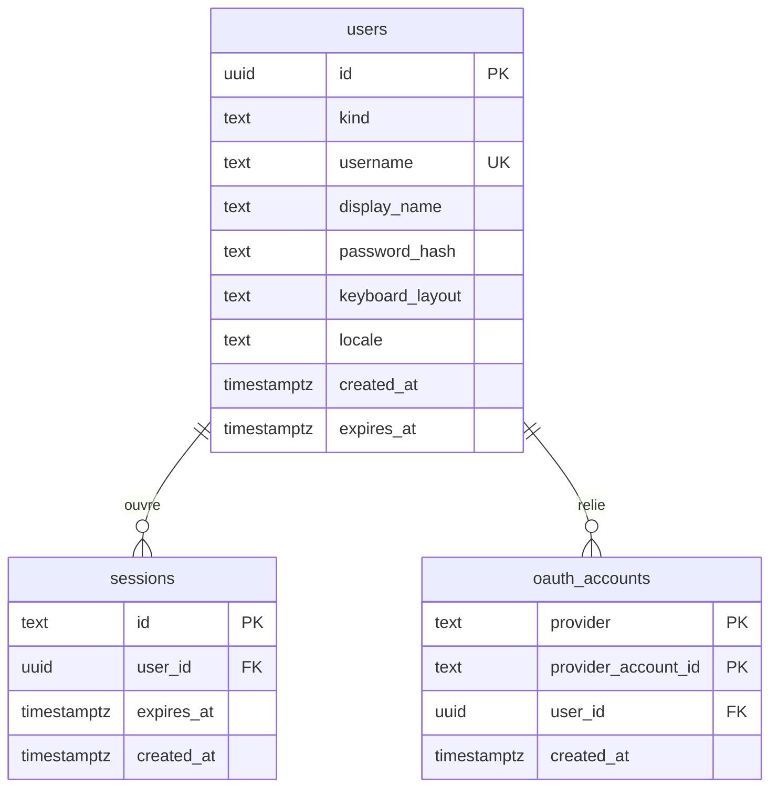
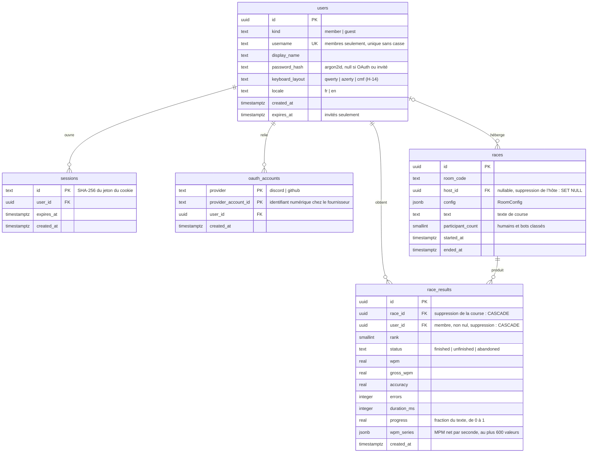
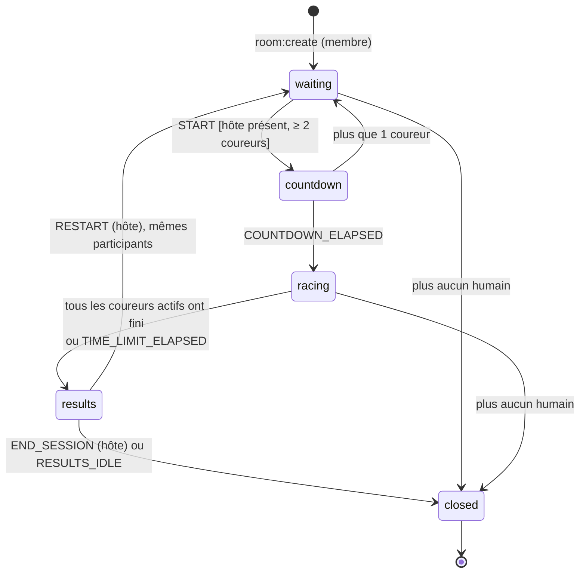
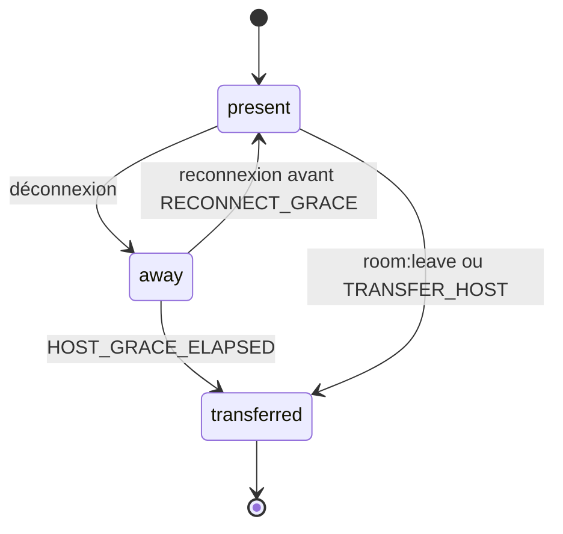
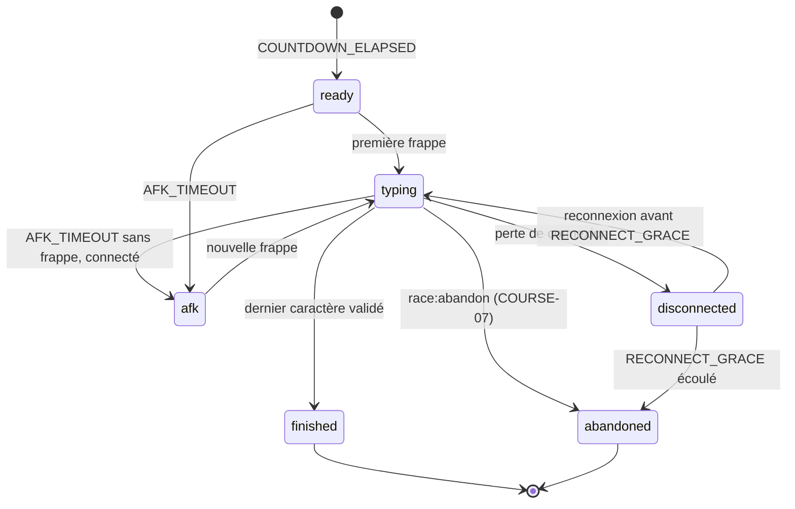
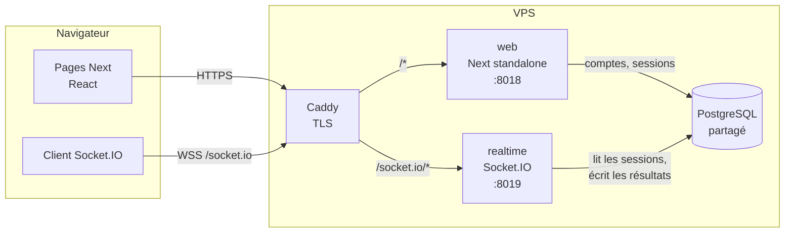
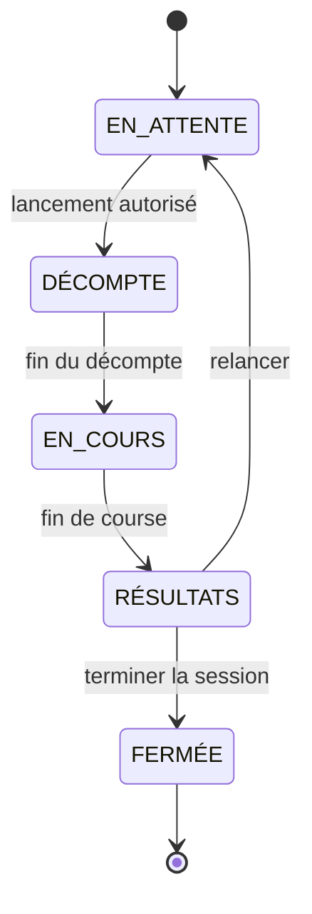
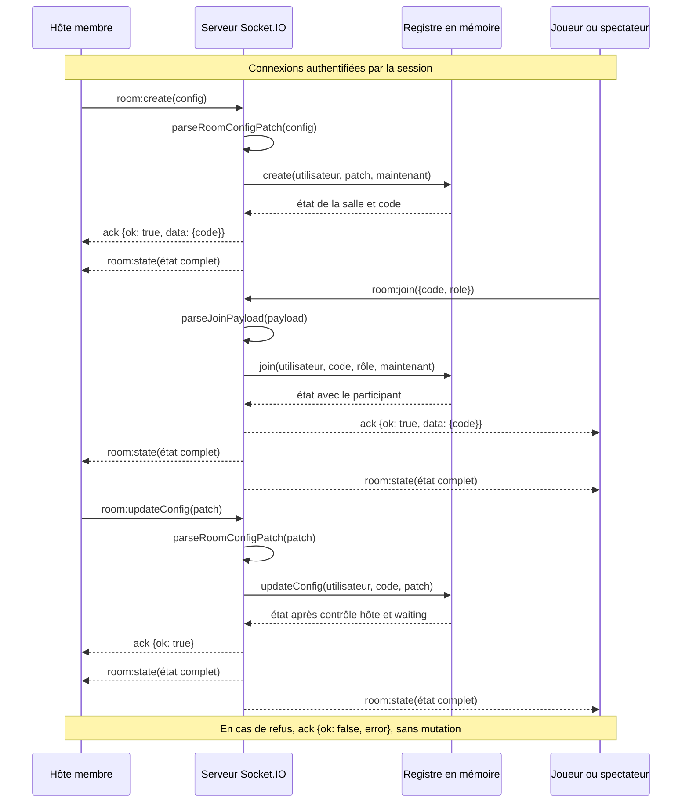

# Architecture

Ce document rassemble intégralement le modèle de données, la machine à états et
l'ADR-001 d'origine. Leurs anciens identifiants d'exigences sont conservés pour la
traçabilité. Les compléments citent les identifiants de l'[énoncé final](enonce.md)
et des [exigences](EXIGENCES.md).

**Lecture de l'état actuel :** les textes d'origine décrivent aussi des décisions
et fonctionnalités prévues. Les sections « Schéma implémenté », « Alignement sur
COURSE-01 », « Flux des messages temps réel » et ADR-002 précisent ce qui existe.
Elles font foi pour distinguer le code actuel de la cible.

- [Modèle de données](#modele-de-donnees)
- [Machine à états d'origine](#machine-a-etats)
- [Alignement sur COURSE-01](#alignement-course-01)
- [ADR-001 — temps réel](#adr-001)
- [Flux des messages temps réel](#flux-temps-reel)
- [ADR-002 — gestion des bots](#adr-002)

# Modèle de données

- **Base :** PostgreSQL (TECH-04), base `typio` sur le serveur partagé du VPS, schéma géré par
  Drizzle (`src/db/schema.ts`, migrations dans `drizzle/`)
- **Principe :** la base garde ce qui doit **durer** (comptes, sessions, courses terminées et
  leurs résultats). Ce qui vit le temps d'une salle (participants, configuration en cours,
  positions, énergie) reste en mémoire dans le service `realtime` ([ADR-001](#adr-001)).

## Schéma

### Authentification

Les trois entités d’authentification sont implémentées dans `src/db/schema.ts`.
Les noms, colonnes et relations correspondent au schéma Drizzle. Les suppressions
se propagent de `users` vers `sessions` et `oauth_accounts` (`onDelete: cascade`).

### Schéma complet implémenté

Les cinq tables sont implémentées dans `src/db/schema.ts`. `races` et `race_results`
(migration 0003, RES-05) sont écrites en une transaction à la fin de chaque course,
sans écriture pendant la course (PERF-02). Seuls les résultats des membres sont
conservés (H-24, AUTH-03) : ni invités, ni bots, ni saisie brute, ni IP.

## Choix et justifications

**Un seul type `users` pour les membres et les invités.** Un invité (AUTH-02, AUTH-03) a lui aussi
une session et peut finir sur un podium. Lui donner une ligne `users` avec
`kind = 'guest'` évite de dédoubler toute la logique de session et de classement.
`expires_at` borne sa durée de vie (H-2 : ses statistiques n'existent que le temps de sa
session). Un invité est supprimé **dès qu'il se déconnecte**. Sinon, un nettoyage le
supprime après expiration : il tourne par lots de 500, au plus une fois par minute, à la
moindre visite (`src/auth/purge.ts`). Aucun résultat d’invité n’est persisté (H-24).
Un pseudo d'invité identique, sans tenir compte de la casse, à
l'identifiant d'un membre est refusé, pour qu'un invité ne puisse pas se faire passer pour
un membre.

**Pas de rôle enseignant.** C-1 est résolu : tout membre peut être hôte. Aucune colonne
`role`.

**Sessions maison, jetons hachés.** Le cookie contient un jeton aléatoire de 32 octets ; la
base ne stocke que son SHA-256. Une fuite de la table ne permet donc pas d'usurper une
session. En production, le cookie s'appelle `__Host-typio_session` (`HttpOnly`, `Secure`,
`SameSite=Lax`, sans `Domain`) : un sous-domaine voisin ne peut pas l'écraser. La session dure
30 jours avec « Rester connecté », sinon 24 h au plus, sans prolongation automatique. Une
nouvelle connexion révoque la session précédente du navigateur. Le service `realtime` lit cette même table pour authentifier chaque connexion
WebSocket : c'est le seul point de contact entre les deux services, en plus des
résultats.

**`password_hash` en argon2id** (SEC-03 ; m = 19 Mio, t = 2, p = 1, d'après l'OWASP), nul
pour les invités. Depuis la migration 0001, un membre peut ne pas en avoir
(compte créé par GitHub ou Discord) ; il exige toujours un `username`. Un compte sans mot de passe
est traité à la connexion comme un identifiant inconnu (hash factice vérifié). Des CHECK bornent `username` à 20 caractères et
`display_name` à 40, en défense en profondeur derrière la validation de l'application.
`username` est unique sans tenir compte de la casse, grâce à un index sur `lower(username)` :
`Patrick` et `patrick` sont le même compte. On évite l'extension `citext`, qu'on ne peut
pas supposer installable sur la base partagée.

**`oauth_accounts` à part** (AUTH-01). La clé `(provider, provider_account_id)`
empêche qu'un même compte Discord ouvre deux comptes Typio, et l'index unique
`(user_id, provider)` (migration 0002) borne un membre à un compte par fournisseur. On ne
stocke que le fournisseur et l'identifiant numérique stable : ni login, ni nom, ni e-mail, ni
avatar, ni jeton d'accès. La table est créée par la migration 0001.

**Pas de liaison pour l'instant.** Un compte GitHub ou Discord n'est jamais relié à un membre
qui existe déjà : à son retour, soit le compte est déjà lié et ouvre une session sur ce membre,
soit un NOUVEAU membre est créé. Lier le compte de qui se présente au membre connecté se
déclenche par une simple navigation, donc permettrait une prise de contrôle silencieuse (un lien
piégé lie le compte de l'attaquant à la victime). La liaison reviendra avec une page « Mon
compte » : action POST explicite, liste des comptes reliés et déliaison. D'ici là, un membre
connecté ne peut pas lancer le flux.

**Nom affiché d'un membre OAuth = son identifiant.** À la création, l'identifiant est dérivé du
login du fournisseur (minuscules, `[a-z0-9_]`, 16 caractères au plus, suffixe `_` + 3 chiffres en
cas de collision) et le nom affiché prend la même valeur. Le `name` ou `global_name` du
fournisseur n'est jamais lu : un nom réel, ou un nom malveillant, n'entre pas dans les parties.
La session ouverte par OAuth dure 24 h, comme une connexion sans « Rester connecté » (poste
partagé).

**Les salles ne sont pas une table.** Une salle d'attente change plusieurs fois par seconde
et ne vaut rien une fois fermée. Son code (H-5) n'a besoin d'être unique que parmi les
salles ouvertes, ce que le service `realtime` garantit en mémoire. Les liens d'invitation
à usage unique (SALLE-04, H-4) expirent au départ de la course : ils vivent avec la salle.
> Révisé par l'énoncé (SALLE-04, H-4 dans EXIGENCES.md) : le lien est à usage unique, lié à l'IP de la première personne, réutilisable par elle pour se reconnecter, révoqué à l'expulsion et invalide à la fermeture de la salle.
`races` et `race_results` sont écrites une seule fois à la fin, dans `syncRace`
(`src/realtime/server.ts`), via le dépôt injecté. Un échec est journalisé sans bloquer
la diffusion et sans nouvelle tentative. Le type membre est conservé depuis les
participants de la salle au départ, jamais fourni par le client.

**`config` en `jsonb`.** La configuration (CONF-03, CONF-02, CONF-06, CONF-04, CONF-07, CONF-01, CONF-08, CONF-10 et BOT-01, CONF-09) évolue avec les fonctionnalités et
est conservée intégralement. Le champ `abilities` permet d’exclure ces courses du
graphique de progression (H-7, C-7).

**Rien pour les personnages.** H-18 débloque les personnages selon le nombre de courses
terminées : c'est un `count(*)` sur `race_results`, pas une table à tenir à jour.

**Série MPM persistée.** `wpm_series` contient le MPM net par seconde depuis le départ
(indice = seconde), au plus 600 valeurs, figées à l’arrivée ou à l’abandon. Elle n’est
pas diffusée dans les instantanés. Les heatmaps (`key_errors`, RES-03) restent prévues.

## Index

| Index | Pour |
|---|---|
| `users (lower(username))` unique | Connexion par identifiant |
| `sessions (user_id)` | Déconnexion de toutes les sessions |
| `sessions (expires_at)` | Nettoyage |
| `users (expires_at) where kind = 'guest'` | Nettoyage des invités |
| `oauth_accounts (provider, provider_account_id)` clé primaire | Retrouver le membre d'un compte GitHub ou Discord |
| `oauth_accounts (user_id, provider)` unique | Un compte par fournisseur et par membre |
| `oauth_accounts (user_id)` | Cascade et liste des comptes d'un membre |
| `race_results (user_id, created_at desc)` | Historique paginé (HIST-01) |
| `race_results (race_id, user_id)` unique | Un résultat par membre et par course |

## Périmètre du checkpoint 1

Seules `users` (membres et invités) et `sessions` sont nécessaires pour le checkpoint :
connexion par identifiants, mode invité, salle rejointe par code. `oauth_accounts`
(AUTH-01) a été ajoutée ensuite. `races` et `race_results` sont maintenant implémentées
pour la persistance des courses et des résultats des membres (RES-05).

# Machine à états — salle, course et coureur

- **Exigences :** SALLE-01, SALLE-05, COURSE-05, COURSE-02, CONF-12, ancien SALLE-13, ancien SALLE-14, SALLE-08, COURSE-03, COURSE-05, COURSE-09, COURSE-08, COURSE-07, ancien COURSE-6, COURSE-11
- **Hypothèses :** H-3 (un bot compte comme coureur), H-9 (délais), H-16 (20 coureurs)
- **Où elle vit :** dans le service `realtime`, qui fait autorité ([ADR-001](#adr-001))

La machine est écrite comme une **fonction pure** : `(état, événement, maintenant) → nouvel
état + effets à exécuter` (diffuser, armer un minuteur, écrire en base). Les minuteurs
sont des événements comme les autres (`COUNTDOWN_ELAPSED`, `HOST_GRACE_ELAPSED`…).
Les tests rejouent donc n'importe quel scénario sans horloge réelle ni réseau.

## Délais (H-9)

| Nom | Valeur | Rôle |
|---|---|---|
| `COUNTDOWN` | 3 s | Compte à rebours avant le départ (COURSE-03) |
| `RECONNECT_GRACE` | 60 s | Un hôte ou un coureur déconnecté garde sa place (ancien SALLE-13, COURSE-08) |
| `AFK_TIMEOUT` | 30 s | Coureur connecté qui ne tape plus (ancien COURSE-6) |
| `DEFAULT_TIME_LIMIT` | 5 min | Limite par défaut si l'hôte n'en fixe pas (CONF-01, C-12) |
| `RESULTS_IDLE` | 10 min | Une salle de résultats sans action est fermée |

## 1. La salle

| État | Ce qui est permis |
|---|---|
| `waiting` | Rejoindre comme coureur ou spectateur ; l'hôte change la config (diffusée à tous, CONF-12), retire un participant, ajoute des bots, transfère son rôle |
| `countdown` | Config verrouillée. Un nouvel arrivant entre comme spectateur. |
| `racing` | Frappes, abandon. Un nouvel arrivant entre comme spectateur. |
| `results` | Consulter le podium ; l'hôte relance ou termine (COURSE-11) |
| `closed` | Plus rien : la salle est retirée de la mémoire, son code est libéré |

**Garde de `START`** : l'émetteur est l'hôte, l'hôte est connecté (ancien SALLE-13 : personne
d'autre ne lance pendant son absence), et la salle compte au moins 2 coureurs, bots
inclus (COURSE-02, H-3). C-4 est résolu ainsi : un élève seul plus un bot fait 2 coureurs.

**Plafond** : 20 coureurs (H-16). Au-delà, `room:join` comme coureur est refusé et la
personne peut entrer en spectatrice.

## 2. Le rôle d'hôte

L'hôte n'est pas un état de la salle : c'est un attribut (`hostId`) avec sa propre petite
machine, valable dans tous les états sauf `closed`.

- **Transfert désigné** (ancien SALLE-14) : l'hôte nomme un participant humain, qui devient
  hôte immédiatement.
- **Transfert automatique** (SALLE-08) : l'hôte part sans désigner personne, ou ne revient
  pas avant `RECONNECT_GRACE`. Le rôle passe au **participant humain connecté le plus
  ancien**, coureur ou spectateur, invités compris. Un bot ne devient jamais hôte.
- S'il ne reste aucun humain, la salle passe à `closed`.

> Un invité ne peut pas *créer* une salle (AUTH-03) mais peut en *hériter*. Le cahier ne
> l'interdit pas, et fermer la salle d'une classe parce que le plus ancien est un invité
> serait pire. **À confirmer** avec le client.

## 3. Le coureur pendant une course

**Coureurs actifs** : `ready`, `typing` et `disconnected`. La course se termine quand il
n'en reste aucun, ou à la limite de temps (COURSE-09).

**C-9 et C-12 résolus** :

- Un coureur déconnecté n'est **pas** AFK. Son minuteur AFK est suspendu ; seul
  `RECONNECT_GRACE` court. À son retour, il reprend à sa position (COURSE-08), puisque le
  serveur la connaît.
- Un coureur `afk` sort du classement actif (ancien COURSE-6) mais peut y revenir en tapant.
  Il ne bloque pas la fin de course : sans limite de temps, la course se termine quand
  tous les autres ont fini.
- La limite de temps par défaut (5 min) garantit qu'une course ne reste jamais bloquée.

## 4. Classement

Le classement se base sur le **pourcentage du texte complété** (H-8), puis, à égalité, sur
l'heure d'arrivée. Pour les coureurs `finished`, le rang est l'ordre d'arrivée.

MPM et précision sont calculés par le serveur à partir des frappes rejouées, jamais reçus
du client :

- **MPM** = (caractères corrects / 5) / minutes écoulées depuis le départ (glossaire : 1 mot = 5 caractères).
- **Précision** = positions du texte réussies au premier essai / positions atteintes
  (glossaire : « du premier coup »). Une faute corrigée ensuite reste une faute.

Les arrondis (affichage à l'entier pour les MPM, à 0,1 % pour la précision) sont proposés
et seront confirmés avec la fonctionnalité de course.

## Transitions refusées

Tout événement non prévu dans l'état courant est ignoré et renvoie `room:error` à
l'émetteur seulement, sans changer l'état. Exemples : `START` émis par un non-hôte
(`NOT_HOST`), `room:updateConfig` pendant `racing` (`CONFIG_LOCKED`), `room:create` par
un invité (`GUEST_CANNOT_CREATE`). Chacun de ces refus est un cas de test.

# ADR-001 — Un service temps réel séparé, Socket.IO, qui fait autorité

- **Statut :** accepté, 3 octobre 2026
- **Exigences :** TECH-06 (WebSockets), COURSE-03, COURSE-05, COURSE-09, COURSE-08, COURSE-06, CONF-12, ancien SALLE-13, ancien SALLE-14, SALLE-08
- **Hypothèses touchées :** H-13 (hébergement), H-9 (délais)

## Contexte

Typio est une course : chaque frappe d'un coureur doit apparaître en moins d'une
fraction de seconde sur les écrans des autres (COURSE-05), et la salle d'attente
reflète en direct la configuration de l'hôte (CONF-12). Il faut donc un canal
persistant, serveur vers client, que HTTP seul ne donne pas.

Trois contraintes réelles pèsent sur le choix :

1. **L'hébergement est un VPS**, pas Vercel. Typio y tourne déjà : image construite par
   GitHub Actions, tirée depuis GHCR, derrière le Caddy existant, avec le PostgreSQL
   partagé de « carte » (voir [stack-docker-postgresql.md](stack-docker-postgresql.md)).
   H-13 supposait Vercel + Render + Neon, justement parce que Vercel ne garde pas de
   WebSockets ouverts (C-16). Sur un VPS, cette raison disparaît.
2. **`output: standalone` est incompatible avec un serveur Next personnalisé.** La doc de
   Next 16 (`01-app/02-guides/custom-server.md`) le dit explicitement : le mode standalone
   produit son propre `server.js` minimal et ne trace pas les fichiers d'un serveur
   personnalisé. Or tout le Dockerfile repose sur standalone, pour tenir dans la mémoire
   du VPS.
3. **La mémoire.** Environ 350 Mo libres sur 1,9 Go, partagés avec huit conteneurs. Le
   conteneur `web` est plafonné à 512 Mo.

S'y ajoute une exigence de conception : **la progression est validée côté serveur**
(COURSE-06). Il faut un processus qui connaît le texte de la course et juge chaque frappe ;
le client ne peut pas être cru sur parole.

## Options étudiées

| | A. Serveur Next personnalisé | **B. Service temps réel séparé** | C. Service géré (Pusher, Ably) |
|---|---|---|---|
| Principe | Un seul processus Node/Bun sert les pages et les WebSockets | Next reste en standalone ; un second processus Socket.IO gère salles et courses | Next publie des événements vers un service tiers |
| Déploiement actuel | À réécrire : on perd standalone, l'image embarque tout `node_modules` | Conservé : même image, un second service compose | Conservé |
| Mémoire VPS | La plus faible | Un second processus, plafonné à 128 Mo | Rien |
| Serveur qui fait autorité (COURSE-06) | Oui | Oui | Non : il faudrait un serveur en plus, on retombe sur A ou B |
| Coût | 0 | 0 | Palier gratuit limité en connexions et en messages : une classe de 30 élèves qui tapent l'épuise vite |
| Couplage | Pages et logique de course dans le même processus : un plantage de la course coupe le site | Le site survit à un plantage de la course, et inversement | Dépendance à un tiers pour le cœur du produit |

## Décision

**Option B.** Un service `realtime`, écrit en TypeScript avec **Socket.IO**, tourne à côté de
Next et fait autorité sur tout ce qui vit pendant une salle et une course.

### Répartition des responsabilités

| `web` (Next) | `realtime` (Socket.IO) |
|---|---|
| Pages, i18n, thème | État des salles en mémoire : participants, configuration, hôte |
| Inscription, connexion, mode invité : crée la session et pose le cookie | Authentifie chaque connexion en lisant ce cookie et la table `sessions` |
| Statistiques, historique (lecture de `race_results`) | Machine à états de la salle et de la course ([machine-a-etats.md](#machine-a-etats)) |
| | Génération du texte, compte à rebours, validation des frappes, classement |
| | Écrit la course et ses résultats en base à la fin |

### Choix détaillés

- **Socket.IO plutôt que `ws` brut.** Il apporte les salles (`io.to(code)`), les accusés de
  réception, la reconnexion automatique côté client et le repli en long polling quand un
  réseau scolaire bloque les WebSockets. C'est exactement ce dont ont besoin ancien SALLE-13 et
  COURSE-08. Le prix, un client de l'ordre de 15 Ko compressés (à mesurer au premier build), est
  acceptable.
- **Même origine.** Caddy route `/socket.io/*` vers `realtime` et le reste vers `web`. Le
  navigateur envoie donc le cookie de session au service temps réel sans configuration
  CORS en production, et le HTTPS (TECH-05) couvre les deux d'un coup.
- **Même image, deux services.** Le service est compilé en un seul fichier par
  `bun build --target=bun`, copié dans l'image `runner` comme `scripts/migrate.ts`, et lancé
  par un second service compose (`command: ["bun", "realtime.js"]`, `mem_limit: 128m`,
  port `127.0.0.1:8019`). Il n'y a ni deuxième image, ni deuxième pipeline CI.
- **L'état vivant reste en mémoire, pas en base.** Une salle d'attente change plusieurs fois
  par seconde et ne vaut rien une fois fermée. Seuls la course terminée et ses résultats
  sont écrits en base (voir [modele-de-donnees.md](#modele-de-donnees)).
- **Le serveur juge les frappes.** Le client envoie ses frappes par paquets
  (`race:input`) ; le serveur les rejoue contre le texte, calcule position, MPM et
  précision, et rejette une cadence humainement impossible (COURSE-06). Le client
  n'affiche que ce que le serveur lui renvoie.
- **Diffusion.** En salle d'attente, le serveur diffuse l'état complet de la salle à chaque
  changement (petit, idempotent, simple à rattraper après une reconnexion). En course,
  il diffuse le classement au plus toutes les 100 ms.

### Protocole (périmètre du checkpoint 1)

| Sens | Événement | Contenu |
|---|---|---|
| client → serveur | `room:create` | configuration initiale ; refusé à un invité (AUTH-03) |
| client → serveur | `room:join` | `code`, rôle `runner` ou `spectator` (SALLE-01, SALLE-05, COURSE-05) |
| client → serveur | `room:updateConfig` | hôte seulement |
| client → serveur | `room:leave` | — |
| serveur → client | `room:state` | état complet de la salle |
| serveur → client | `room:error` | code d'erreur traduisible côté client (`ROOM_NOT_FOUND`, `NOT_HOST`, `GUEST_CANNOT_CREATE`…) |

Les événements de course (`race:start`, `race:countdown`, `race:input`, `race:progress`,
`race:finished`) suivent la même convention ; ils seront détaillés avec la fonctionnalité.

## Conséquences

**Positives**

- La chaîne de déploiement existante ne change que par l'ajout d'un service compose et
  d'une route Caddy.
- La logique de course est un module TypeScript pur, testable sans navigateur ni réseau :
  la machine à états prend un état et un événement et rend un nouvel état.
- Un plantage du service temps réel n'emporte pas le site, et inversement.

**Négatives, assumées**

- **Un seul processus `realtime`.** Il héberge toutes les salles et toutes les courses
  simultanées, chacune isolée dans sa salle Socket.IO : dix classes peuvent courir en même
  temps. Ce qu'il ne permet pas, c'est de répartir la charge sur plusieurs processus, car
  leur mémoire n'est pas partagée : il faudrait alors un adaptateur Redis. Pour un
  établissement, un processus suffit ; sa capacité réelle sera mesurée par un test de
  charge avec la fonctionnalité « salle ».
- **Un redémarrage perd les salles ouvertes.** Un déploiement pendant une course la
  coupe. Il faut déployer hors des heures d'usage ; les courses déjà terminées sont en base.
- **Deux processus en développement.** `bun run dev` lance Next, et un second script lance
  `realtime`. En local, le client vise `NEXT_PUBLIC_REALTIME_URL` (par défaut la même
  origine) ; les cookies passent, car ils ignorent le port.
- **Socket.IO sous Bun est à vérifier.** Socket.IO cible Node ; Bun implémente `node:http`.
  La première tâche de la fonctionnalité « salle » est un essai minimal : connexion,
  salle, reconnexion, sous `bun`, dans l'image. En cas d'échec, l'image runner reçoit Node
  pour ce seul service, sans changer le reste de la décision.

## Suites

- Réviser H-13 dans le cahier des charges, avec un renvoi vers cet ADR.
- Ajouter le service `realtime` à `docker-compose.yml`, à `infra/docker-compose.yml` et la
  route `/socket.io/*` à `infra/caddy/typio.caddyfile`.

# Alignement sur COURSE-01

La machine exigée par l'énoncé final est la suivante. Les identifiants Mermaid
sans accents portent exactement les libellés demandés.

| COURSE-01 | `RoomStatus` (`src/realtime/protocol.ts`) | `RaceLifecycle` (`src/race/lifecycle.ts`) |
|---|---|---|
| `EN_ATTENTE` | `waiting` | `preparing` |
| `DÉCOMPTE` | `countdown` | `countdown` |
| `EN_COURS` | `racing` | `racing` |
| `RÉSULTATS` | `results` | `results` |
| `FERMÉE` | `closed` | absent |

**État actuel.** `transitionRace` est une fonction pure utilisée pour la course
solo. `start` fixe un départ après 3 s ; `tick` passe en course puis aux résultats
à la limite de temps. `complete` et `abandon` terminent la course.
`reset` revient de `results` à `preparing`. La fermeture n'est pas implémentée
dans cette machine. Les gardes d'hôte et de participants sont laissées à l'appelant.

`src/race/round.ts` assemble le joueur et les bots pour le solo.
`snapshotRound` n'expose que `countdown`, `racing`, `results` ; il ramène aussi
`preparing` à `countdown` pour l'affichage. Ce n'est pas la machine de salle.
Le protocole déclare les cinq états de salle, mais le service actuel ne lance
pas de course multijoueur. La fermeture existe lors du retrait du dernier humain.

**Écarts à traiter.** La machine complète COURSE-01 côté serveur temps réel reste
**prévue**, avec validation des gardes et autorité du serveur (COURSE-06).
`RECONNECT_GRACE_MS` vaut actuellement **60 s**, comme le texte d'origine ci-dessus ;
COURSE-08 exige **30 s**. Aucun changement de délai n'est fait dans ce lot documentaire.
Pour SALLE-08, `src/realtime/roomStore.ts` transfère automatiquement l'hôte au
participant humain connecté le plus ancien après départ ou expiration de la grâce.
Le transfert désigné décrit dans le texte d'origine reste **prévu** : aucun
événement correspondant n'est déclaré dans le protocole actuel.

# Flux des messages temps réel

**Implémenté (TECH-06).** Les événements applicatifs suivants sont ceux de
`ClientToServerEvents` et `ServerToClientEvents` dans `src/realtime/protocol.ts`.

| Événement | Sens | Rôle |
|---|---|---|
| `room:create` | client → serveur | Créer une salle avec un patch de configuration ; membre seulement ; devient hôte et coureur. Accusé avec le code. |
| `room:join` | client → serveur | Rejoindre par code comme `runner` ou `spectator`. Accusé avec le code, ou refus si code invalide, salle pleine, etc. |
| `room:updateConfig` | client → serveur | Appliquer un patch ; hôte seulement, en `waiting`. Accusé de succès ou d'erreur. |
| `room:leave` | client → serveur | Quitter la salle ; accusé, puis état actualisé et retrait des sockets. |
| `race:start` | client → serveur | `{}` et accusé ; hôte seulement en `waiting`, graine cryptographique serveur (COURSE-02). |
| `race:input` | client → serveur | `{ ops: string[] }`, au plus 64 opérations d’un point de code ou retour arrière ; sans accusé, refus par `room:error` à l’émetteur. |
| `race:abandon` | client → serveur | `{}` et accusé ; abandon du coureur authentifié (COURSE-07). |
| `room:restart` | client → serveur | `{}` et accusé ; hôte en `results`, retour à `waiting` avec les mêmes participants (COURSE-11). |
| `room:close` | client → serveur | `{}` et accusé ; hôte en `results`, diffusion de `closed`, retrait des sockets et libération du code. |
| `race:state` | serveur → client | Instantané public du moteur au décompte, aux transitions, puis au plus toutes les 100 ms pendant la course. |
| `race:results` | serveur → client | Classement final, aussi envoyé à l’arrivée ou à la reconnexion en `results`. |
| `race:self` | serveur → client | `{ typed, keystrokes }`, uniquement aux sockets du coureur lors de sa reprise. |
| `room:state` | serveur → client | Diffuser l'état complet : code, statut, hôte, configuration, participants et plafond. |
| `room:error` | serveur → client | Signaler une erreur hors accusé avec un `RoomErrorCode`, traduit par le client. |

Chaque commande sauf `race:input` exige un accusé de réception : `{ ok: true }`, avec `data.code`
pour créer ou rejoindre, ou `{ ok: false, error }`. Les refus sont renvoyés par
cet accusé ; `room:error` est un canal distinct. Le transport gère aussi ses
événements de connexion et déconnexion, qui ne sont pas des commandes métier.

Les gestionnaires de `src/realtime/roomHandlers.ts` valident, modifient le registre,
accusent réception, puis diffusent. L'identité vient de la session authentifiée,
jamais d'un identifiant fourni dans la charge utile. Les sockets des autres
onglets du même utilisateur sont rattachés ensemble.

**Validation (TECH-07).** Les charges utiles arrivent comme `unknown`.
`parseRoomConfigPatch` borne les valeurs et rejette les clés inconnues.
`parseJoinPayload` contrôle le code et le rôle ; il ne rejette pas les clés
supplémentaires. `room:leave` n'a pas de charge utile et son accusé doit être une
fonction. Il s'agit aujourd'hui de validateurs manuels, pas d'un schéma déclaratif
commun à toutes les entrées serveur. La validation par schéma de toutes les
entrées reste **prévue** pour TECH-07. Les parseurs de course refusent les objets
non simples et les clés inconnues, y compris une identité fournie par le client.

**Course multijoueur — implémenté.** Le registre garde la course privée, sans la
joindre à `room:state`. Le serveur valide les frappes et calcule la progression
(COURSE-06). Un intervalle par salle fait avancer le moteur toutes les 100 ms ;
il s’arrête en `results`, à la fermeture ou au départ du dernier humain.
`room:join` refuse les nouveaux participants pendant `countdown` et `racing`
(`RACE_IN_PROGRESS`) et les accepte en `results` (SALLE-09).

La limite réseau est de **12 messages `race:input` par seconde et par utilisateur**,
partagée entre ses onglets, en fenêtre glissante ; l’excédent est ignoré (PERF-02).
Une saisie invalide ou une cadence de frappes impossible reçoit `INPUT_REJECTED` ;
hors course, `RACE_NOT_RUNNING`. La reprise conserve la saisie pendant **30 s**
(COURSE-08), puis le coureur déconnecté abandonne et quitte la salle.
Aucune écriture en base par frappe ; la persistance des courses reste à réaliser.

# ADR-002 — Gestion des bots

- **Statut :** proposé
- **Exigences :** BOT-01 à BOT-05, COURSE-06, PERF-02, TECH-07

## Contexte et état actuel

`src/race/bots.ts` est un module pur. `planBot` précalcule une courbe temps →
caractères corrects, et `botProgressAt` l'interroge sans horloge interne.
Le hasard est injecté comme fonction `random`, ce qui permet les tests déterministes.

| Niveau actuel | Vitesse cible |
|---|---|
| `easy` | 25 MPM |
| `normal` | 40 MPM |
| `hard` | 60 MPM |

La durée par mot varie de ±20 %. Une pause survient avec une probabilité de 5 %
par mot, pendant 200 à 800 ms. Une faute corrigée survient avec une probabilité de
3 % **par mot**, identique pour les trois niveaux : ce n'est pas un taux d'erreur
par caractère. Sa correction ajoute deux frappes et 150 à 400 ms de réaction.
Le départ est retardé de 150 à 450 ms. Le temps de frappe est ajusté pour compenser
en moyenne les pauses et corrections et rester proche de la vitesse cible.

Les bots ne produisent pas de vraies commandes de saisie : leurs fautes forment
des pauses dans une progression qui ne recule pas. `planBot` ne reçoit pas le
mode d'erreur. Il ne peut donc pas en appliquer les règles. Les fautes sont
comptées pour la précision par `botKeystrokesAt`.

Aujourd'hui, `src/race/round.ts` crée ces plans pour la course **solo**, animée
côté navigateur par `src/components/race/useRaceSession.ts`. Les identifiants
`bot-*` et `isPlayer: false` distinguent les bots dans les données ;
l'identification visible et la soumission aux bonus de l'énoncé final restent
à compléter. Les bots ne sont pas encore simulés dans `src/realtime/`.
`src/race/seededRandom.ts` fournit déjà `createSeededRandom` ; `createRound` l'utilise
pour mélanger les noms, mais reçoit séparément le hasard des plans.
Une graine unique pour toute la simulation multijoueur reste à intégrer.

## Décision proposée

Simuler les bots dans le **serveur temps réel autoritaire** (COURSE-06), avec la
même horloge de course et les mêmes règles que les humains. Le client affiche
les instantanés reçus. Réutiliser les fonctions pures existantes là où leurs
règles conviennent ; adapter le moteur pour BOT-01 à BOT-05.

| Niveau prévu (BOT-01) | Vitesse | Erreurs approximatives |
|---|---|---|
| Noob | 10–20 MPM | 12 % |
| Débutant | 20–35 MPM | 8 % |
| Intermédiaire | 35–60 MPM | 5 % |
| Expert | 70–100 MPM | 2 % |
| Impossible | 140+ MPM | 0,5 % |

- Faire varier la vitesse pendant la course et garder des pauses (BOT-02).
- Simuler les erreurs, leur temps de correction et le mode d'erreur choisi
  (BOT-03). Définir l'unité de mesure des taux pour pouvoir les tester.
- Identifier clairement les bots et leur appliquer les bonus et effets avec
  les mêmes règles que les humains (BOT-04).
- Utiliser un générateur pseudo-aléatoire à graine pour toute la simulation
  (BOT-05). À texte, configuration, graine et instants identiques, obtenir les
  mêmes frappes, erreurs et résultats, sans dépendre de l'horloge réelle.
- Valider la configuration reçue par schéma (TECH-07) ; intégrer les bots aux
  diffusions bornées de progression (PERF-02).

## Conséquences et travail restant

Le serveur pourra rejouer un scénario de test et décider du classement sans
faire confiance au navigateur. Il devra supporter le coût de toutes les
simulations et gérer leur arrêt, les bonus et la fin de course.

Restent **prévus** : les cinq niveaux dans la configuration et l'interface,
le moteur respectant le mode d'erreur, les bonus, l'exécution serveur, la graine
de course et les tests des vitesses, erreurs et relectures déterministes.
Cet ADR n'affirme pas que BOT-01 à BOT-05 sont déjà satisfaites.
