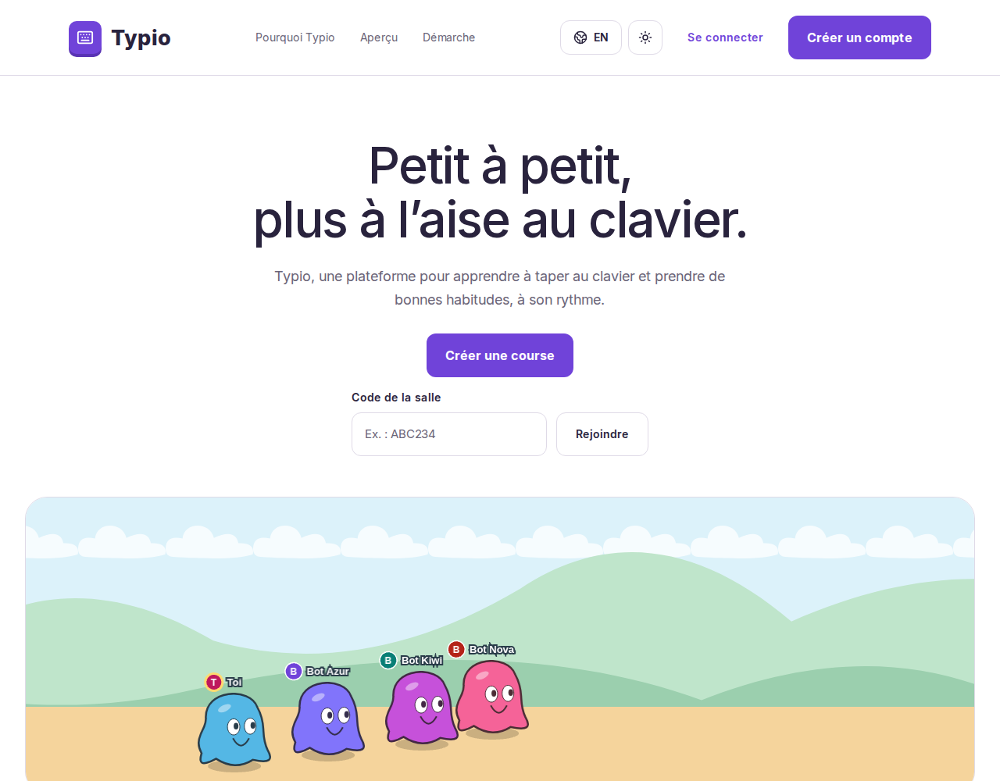
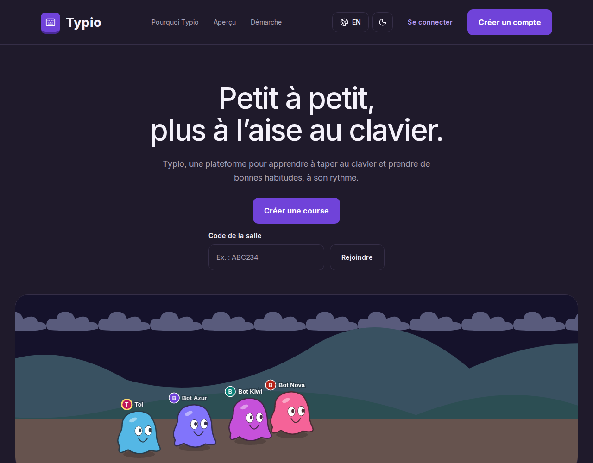
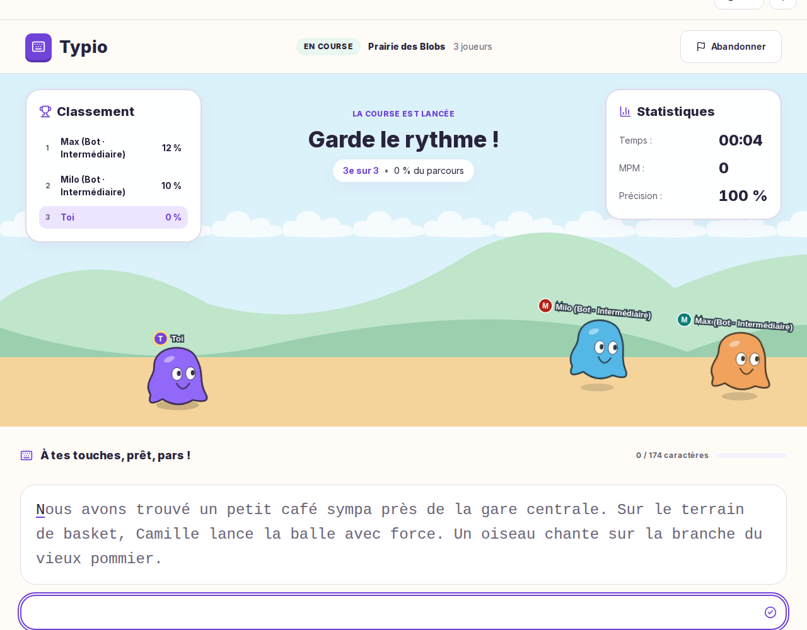
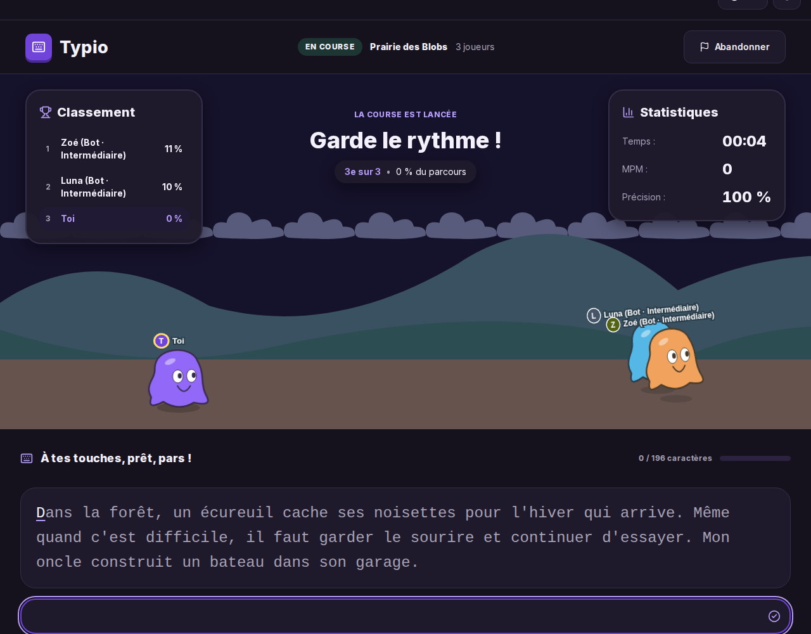
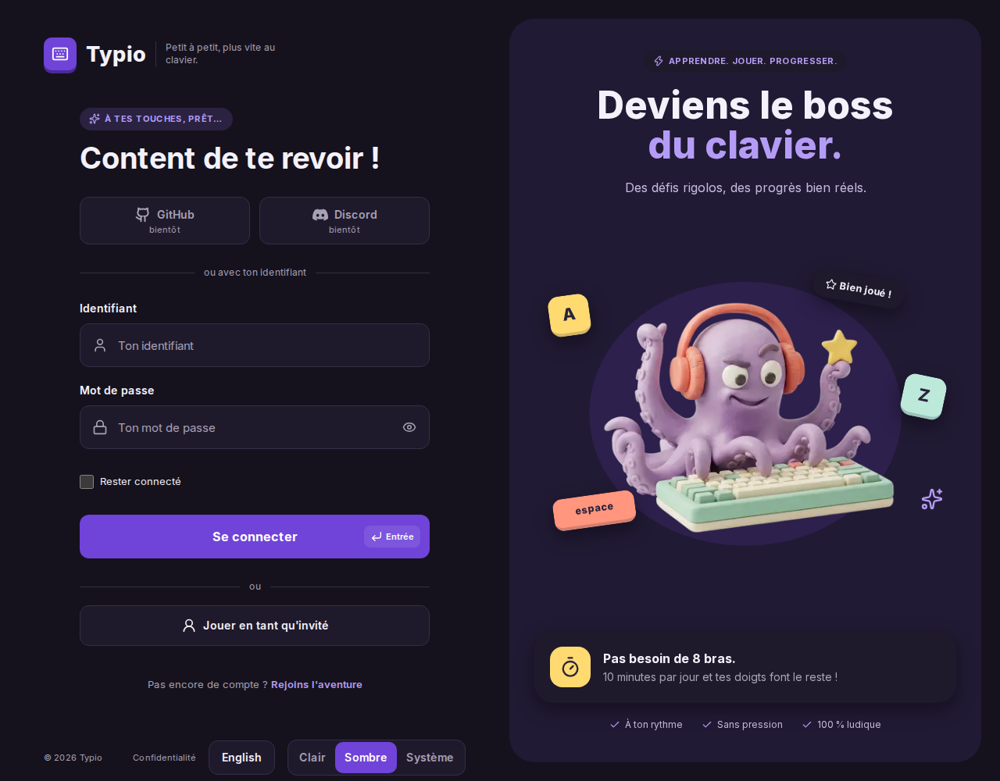
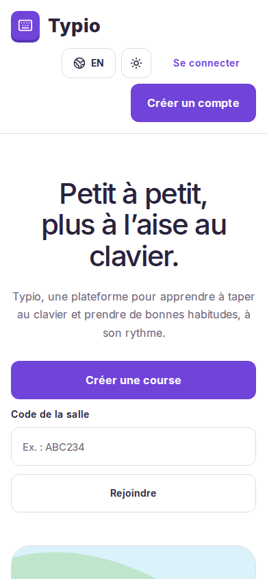
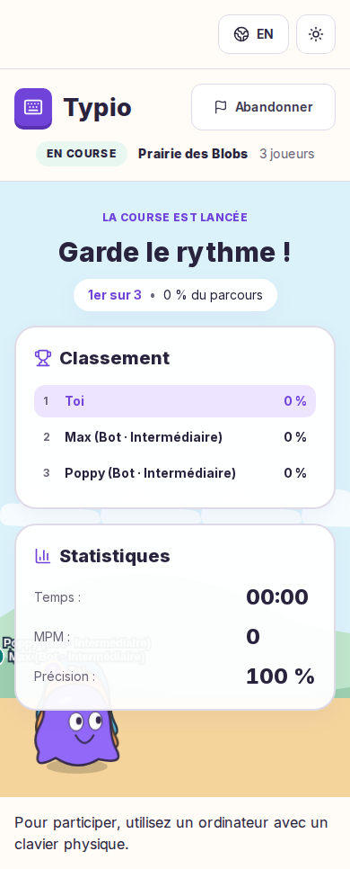

# Démarche créative

Squelette pour documenter DES-01 à DES-03. Le nom et le logo doivent venir de
Patrick, sans génération par IA. Les références au dépôt ci-dessous servent
uniquement à retrouver les éléments existants.

## Nom

> À compléter par Patrick : présenter les noms envisagés personnellement, les
> recherches d'originalité (sources, dates et résultats), le nom retenu et la
> raison du choix. Joindre les traces de cette démarche.

## Logo

> À compléter par Patrick : joindre les photos des croquis réalisés sur papier
> ou tablette, expliquer le choix et la vectorisation, puis montrer le logo
> vectoriel et son adaptation en favicon, lisible en petite taille.

Repère existant : `src/components/Logo.tsx`.

## Moodboard

> À compléter par Patrick : réunir 3 à 5 références visuelles, avec leur source
> et leur auteur si connu. Expliquer pour chacune ce qui nourrit la direction
> choisie et comment elle répond au public et à l'usage.

Repères existants : `docs/design/`, dont `docs/design/login/README.md` et sa maquette.

## Palette

Les valeurs viennent de `src/app/globals.css` (`:root` et `.dark`).
`--heat-0` reprend `--surface`. L’ombre `--shadow-soft` utilise une valeur
RGBA : `0 8px 24px rgba(83, 53, 155, 0.05)` en clair et
`0 8px 24px rgba(0, 0, 0, 0.4)` en sombre.

### Thème clair

| Token | Code hexadécimal | Rôle |
|---|---|---|
| `--heat-0` | `#ffffff` | Carte des touches : aucune erreur (alias de surface) |
| `--heat-1` | `#eee7fc` | Carte des touches : intensité faible |
| `--heat-2` | `#d3c1f5` | Carte des touches : intensité moyenne |
| `--heat-3` | `#b49cf6` | Carte des touches : intensité forte |
| `--background` | `#fffcf7` | Fond de page |
| `--series-1` | `#7043d9` | Courbe MPM : série 1 |
| `--series-2` | `#087f76` | Courbe MPM : série 2 |
| `--series-3` | `#b45309` | Courbe MPM : série 3 |
| `--series-4` | `#be185d` | Courbe MPM : série 4 |
| `--series-5` | `#2563eb` | Courbe MPM : série 5 |
| `--series-6` | `#526515` | Courbe MPM : série 6 |
| `--avatar-1` | `#7043d9` | Fond d’avatar généré : variante 1 |
| `--avatar-2` | `#087f76` | Fond d’avatar généré : variante 2 |
| `--avatar-3` | `#b45309` | Fond d’avatar généré : variante 3 |
| `--avatar-4` | `#be185d` | Fond d’avatar généré : variante 4 |
| `--avatar-5` | `#2563eb` | Fond d’avatar généré : variante 5 |
| `--avatar-6` | `#526515` | Fond d’avatar généré : variante 6 |
| `--avatar-7` | `#b42318` | Fond d’avatar généré : variante 7 |
| `--avatar-8` | `#475569` | Fond d’avatar généré : variante 8 |
| `--avatar-foreground` | `#ffffff` | Initiale des avatars générés |
| `--surface` | `#ffffff` | Fond des cartes et des champs |
| `--foreground` | `#29233d` | Texte principal |
| `--muted` | `#6a6477` | Texte secondaire |
| `--muted-strong` | `#65577e` | Texte secondaire renforcé |
| `--border` | `#dfdae7` | Bordures |
| `--accent` | `#7043d9` | Fond des actions principales |
| `--accent-foreground` | `#ffffff` | Texte sur les actions principales |
| `--accent-text` | `#7043d9` | Liens et texte accentué |
| `--accent-shadow` | `#5933b4` | Ombre des actions principales |
| `--accent-soft` | `#f6f1ff` | Fond des encarts et sélections |
| `--accent-panel` | `#ede5ff` | Fond des panneaux violets |
| `--key-yellow` | `#ffda70` | Touche décorative jaune |
| `--key-mint` | `#bce9da` | Touche décorative menthe |
| `--key-coral` | `#ff967d` | Touche décorative corail |
| `--key-ink` | `#29233d` | Texte des touches décoratives |
| `--island-sand` | `#fff8e8` | Fond sable du panneau d’inscription |
| `--island-mint` | `#e8f7f0` | Colline du panneau d’inscription |
| `--danger` | `#b42318` | Erreurs et alertes |
| `--success` | `#059669` | Caractères correctement saisis |

### Thème sombre

| Token | Code hexadécimal | Rôle |
|---|---|---|
| `--heat-0` | `#1f1a2b` | Carte des touches : aucune erreur (alias de surface) |
| `--heat-1` | `#33254c` | Carte des touches : intensité faible |
| `--heat-2` | `#4b3470` | Carte des touches : intensité moyenne |
| `--heat-3` | `#65468e` | Carte des touches : intensité forte |
| `--background` | `#15121d` | Fond de page |
| `--series-1` | `#b49cf6` | Courbe MPM : série 1 |
| `--series-2` | `#5eead4` | Courbe MPM : série 2 |
| `--series-3` | `#fbbf24` | Courbe MPM : série 3 |
| `--series-4` | `#f9a8d4` | Courbe MPM : série 4 |
| `--series-5` | `#93c5fd` | Courbe MPM : série 5 |
| `--series-6` | `#c4d971` | Courbe MPM : série 6 |
| `--avatar-1` | `#7043d9` | Fond d’avatar généré : variante 1 |
| `--avatar-2` | `#087f76` | Fond d’avatar généré : variante 2 |
| `--avatar-3` | `#b45309` | Fond d’avatar généré : variante 3 |
| `--avatar-4` | `#be185d` | Fond d’avatar généré : variante 4 |
| `--avatar-5` | `#2563eb` | Fond d’avatar généré : variante 5 |
| `--avatar-6` | `#526515` | Fond d’avatar généré : variante 6 |
| `--avatar-7` | `#b42318` | Fond d’avatar généré : variante 7 |
| `--avatar-8` | `#475569` | Fond d’avatar généré : variante 8 |
| `--avatar-foreground` | `#ffffff` | Initiale des avatars générés |
| `--surface` | `#1f1a2b` | Fond des cartes et des champs |
| `--foreground` | `#f4f1fa` | Texte principal |
| `--muted` | `#a7a1b6` | Texte secondaire |
| `--muted-strong` | `#c4b9dc` | Texte secondaire renforcé |
| `--border` | `#352e47` | Bordures |
| `--accent` | `#7043d9` | Fond des actions principales |
| `--accent-foreground` | `#ffffff` | Texte sur les actions principales |
| `--accent-text` | `#b49cf6` | Liens et texte accentué |
| `--accent-shadow` | `#4a2a99` | Ombre des actions principales |
| `--accent-soft` | `#2a2240` | Fond des encarts et sélections |
| `--accent-panel` | `#211a34` | Fond des panneaux violets |
| `--key-yellow` | `#ffda70` | Touche décorative jaune |
| `--key-mint` | `#bce9da` | Touche décorative menthe |
| `--key-coral` | `#ff967d` | Touche décorative corail |
| `--key-ink` | `#29233d` | Texte des touches décoratives |
| `--island-sand` | `#2c2530` | Fond sable du panneau d’inscription |
| `--island-mint` | `#1e3633` | Colline du panneau d’inscription |
| `--danger` | `#ff9b8a` | Erreurs et alertes |
| `--success` | `#34d399` | Caractères correctement saisis |

### Contrastes texte / fond

Rapports calculés à partir des tokens avec la formule WCAG 2.x de
`src/theme/contrast.test.ts` : linéarisation sRGB, luminance
`0,2126 R + 0,7152 G + 0,0722 B`, puis `(L claire + 0,05) / (L sombre + 0,05)`.
Les valeurs ci-dessous sont arrondies à deux décimales. Toutes ces paires
atteignent le seuil AA de **4,5:1 pour le texte courant** avant arrondi.
Ce relevé couvre les paires et la pastille Entrée vérifiées par ce test,
pas un audit exhaustif de tous les états de l’interface.

| Texte / fond | Clair | Sombre |
|---|---:|---:|
| `foreground` / `background` | 14,63:1 | 16,56:1 |
| `foreground` / `surface` | 14,98:1 | 15,16:1 |
| `foreground` / `heat-1` | 12,46:1 | 12,46:1 |
| `foreground` / `heat-2` | 9,07:1 | 9,29:1 |
| `foreground` / `heat-3` | 6,44:1 | 6,67:1 |
| `muted` / `background` | 5,54:1 | 7,41:1 |
| `muted` / `surface` | 5,67:1 | 6,78:1 |
| `muted` / `accent-panel` | 4,66:1 | 6,67:1 |
| `muted` / `accent-soft` | 5,12:1 | 6,01:1 |
| `muted` / `island-mint` | 5,13:1 | 5,16:1 |
| `muted` / `island-sand` | 5,36:1 | 5,95:1 |
| `muted-strong` / `accent-panel` | 5,36:1 | 8,97:1 |
| `accent-text` / `background` | 5,87:1 | 7,95:1 |
| `accent-text` / `surface` | 6,01:1 | 7,27:1 |
| `accent-foreground` / `accent` | 6,01:1 | 6,01:1 |
| `key-ink` / `key-yellow` | 11,07:1 | 11,07:1 |
| `key-ink` / `key-mint` | 11,27:1 | 11,27:1 |
| `key-ink` / `key-coral` | 7,07:1 | 7,07:1 |
| `danger` / `background` | 6,42:1 | 9,07:1 |
| `danger` / `surface` | 6,57:1 | 8,31:1 |
| `accent-text` / `accent-soft` | 5,42:1 | 6,44:1 |
| `foreground` / `accent-soft` | 13,51:1 | 13,42:1 |
| `foreground` / `accent-panel` | 12,31:1 | 14,90:1 |
| `accent-text` / `accent-panel` | 4,94:1 | 7,15:1 |
| `foreground` / `island-sand` | 14,15:1 | 13,30:1 |
| `foreground` / `island-mint` | 13,55:1 | 11,53:1 |
| `avatar-foreground` / `avatar-1` | 6,01:1 | 6,01:1 |
| `avatar-foreground` / `avatar-2` | 4,88:1 | 4,88:1 |
| `avatar-foreground` / `avatar-3` | 5,02:1 | 5,02:1 |
| `avatar-foreground` / `avatar-4` | 6,04:1 | 6,04:1 |
| `avatar-foreground` / `avatar-5` | 5,17:1 | 5,17:1 |
| `avatar-foreground` / `avatar-6` | 6,50:1 | 6,50:1 |
| `avatar-foreground` / `avatar-7` | 6,57:1 | 6,57:1 |
| `avatar-foreground` / `avatar-8` | 7,58:1 | 7,58:1 |
| `accent-foreground` / `accent` avec 10 % de blanc (pastille Entrée) | 4,93:1 | 4,93:1 |

Ce test s’exécute en CI avec `bun run test` (`.github/workflows/ci.yml`).
Il vérifie les paires des deux thèmes, la pastille Entrée et la présence des
mêmes tokens dans les deux palettes.

À compléter par Patrick : raison du choix.

Repère existant : tokens de `src/app/globals.css`.

## Typographies

Inter est chargée par `next/font/google` dans `src/app/[lang]/layout.tsx`,
avec les sous-ensembles `latin` et `latin-ext`, `display: "swap"` et la variable
`--font-inter`. Elle est téléchargée au build et servie par le site.
Sa licence est la [SIL Open Font License 1.1](https://github.com/rsms/inter/blob/master/LICENSE.txt).
La pile `--font-sans` de `src/app/globals.css` est :
`var(--font-inter), ui-sans-serif, system-ui, -apple-system, "Segoe UI", Roboto, "Helvetica Neue", Arial, sans-serif`.

Le texte à recopier et le champ de saisie de `RaceTypingPanel.tsx` utilisent
`font-mono`. C’est la pile de Tailwind, sans police téléchargée dédiée :
`ui-monospace, SFMono-Regular, Menlo, Monaco, Consolas, "Liberation Mono", "Courier New", monospace`.

| Usage et repère | Taille | Graisse |
|---|---|---|
| Titre d’accueil (`HomeHero.tsx`) | 42 px, puis 60 px dès `sm`, 64 px dès `lg` | 500 (`font-medium`) |
| Titres de section d’accueil (`HomeWhySection.tsx`, `HomeVideoSection.tsx`) | 30 px, puis 42 px dès `sm` | 500 |
| Texte courant d’accueil | 16 px, puis 18 px dès `sm` | 400 |
| Titres classement et statistiques (`RaceScreen.tsx`) | 20 px | 800 (`font-extrabold`) |
| Texte à recopier (`RaceTypingPanel.tsx`) | 18 px, puis 24 px dès `sm` | 400 |
| Champ de saisie de course | 18 px | 400 |

Les tailles en `rem` sont converties ici pour une base de 16 px.
Les seuils Tailwind sont `sm: 40rem` (640 px) et `lg: 64rem` (1 024 px).
Les captures ci-dessous montrent ces usages dans l’interface.

À compléter par Patrick : raison du choix.

## Thèmes clair/sombre (DES-05)

Sans choix enregistré, le thème suit `prefers-color-scheme` du système.
La bascule propose système, clair et sombre ; le choix est mémorisé sous
`typio-theme` dans `localStorage` (`src/theme/theme.ts`, `themeStore.ts`).
Le script `src/theme/themeScript.ts`, injecté dans le `<head>` par le layout,
pose la classe `dark` avant le premier affichage pour éviter un flash de thème.

Les composants reprennent les tokens des deux palettes. Dans la piste,
`SCENE_COLORS` de `src/components/race/RaceVisualizer.tsx` change le fond
(`#dcf2fa` en clair, `#15122b` en sombre) et teinte les calques de décor en
sombre : nuages `#6f7396`, prairie lointaine `#4c5a7a`, prairie `#48607a`,
piste `#6a6480`. En clair, la teinte `#ffffff` conserve les décors d’origine.

| Écran | Clair | Sombre |
|---|---|---|
| Accueil |  |  |
| Course (production) |  |  |
| Connexion |  |  |

Les contrastes des tokens sont détaillés dans la section Palette.
`e2e/preferences.spec.ts` vérifie la conservation du choix après rechargement.
`e2e/a11y.spec.ts` audite les écrans avec axe dans les deux thèmes ; le canvas
est exclu de l’audit des courses.

Repère existant : tokens de `src/app/globals.css` et composants de `src/components/`.

## Responsive (DES-06)

Le périmètre prévu par DES-06 commence à **360 px de largeur**.
`docs/EXIGENCES.md` consigne une vérification de la salle à 360 et 375 px
sans défilement horizontal. Les captures fournies ici mesurent 390 × 844 px
sur mobile et 1 280 px de large sur ordinateur.

À l’accueil, le formulaire de code passe d’une colonne à une ligne dès `sm`
(`HomeJoinCodeForm.tsx`). Les actions de l’en-tête peuvent revenir à la ligne ;
la navigation de section est masquée sous `lg` (`SiteHeader.tsx`).
Dans la course, l’en-tête revient à la ligne et le classement et les
statistiques s’empilent sur petit écran (`RaceScreen.tsx`).

`src/components/race/usePhysicalKeyboard.ts` autorise la saisie si la requête
`(min-width: 768px) and (pointer: fine)` correspond. C’est une condition de
largeur et de pointeur, pas une détection matérielle du clavier.
Sinon, `RaceScreen.tsx` et `RoomRaceView.tsx` remplacent la zone de frappe par :
« Pour participer, utilisez un ordinateur avec un clavier physique. »
La piste reste affichée.

Capture pleine page prise en production à 390 px avec un écran tactile émulé :
le message de clavier physique apparaît sous la piste, à la place de la zone
de frappe.

Le test unitaire DES-06 de `src/components/race/RaceScreen.test.tsx` vérifie
le remplacement de la saisie en français et en anglais. Il n’y a pas de test
E2E mobile dédié dans `e2e/` : `playwright.config.ts` utilise Desktop Chrome.
`e2e/preferences.spec.ts` couvre le thème et `e2e/keyboard.spec.ts` le parcours
au clavier, sans valider la mise en page à 360 px.
